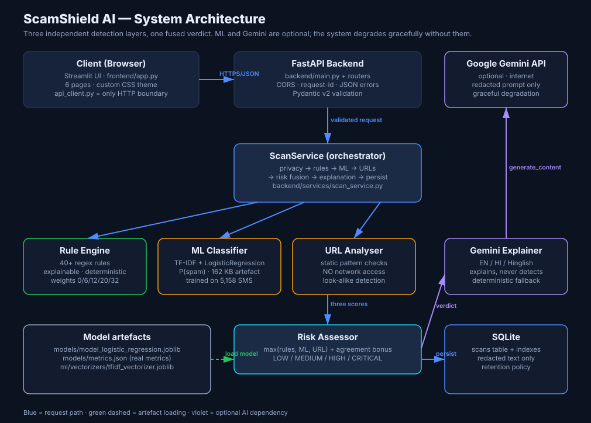
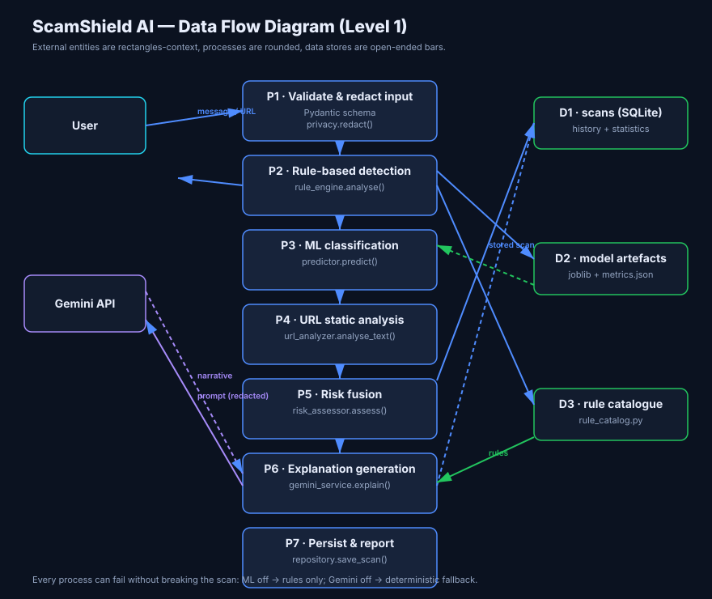
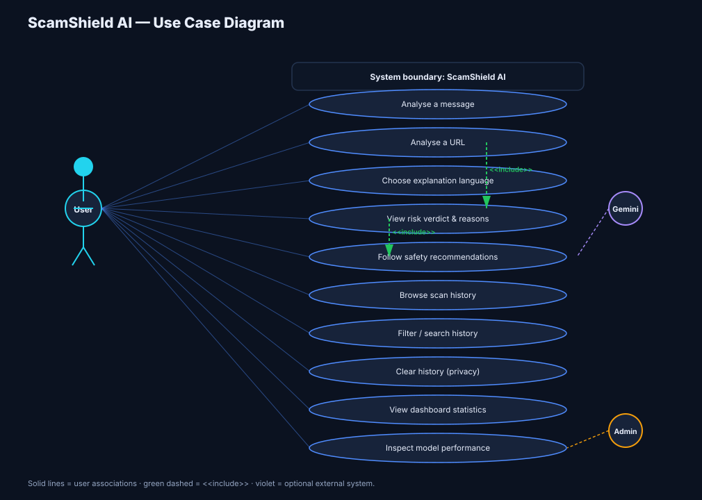
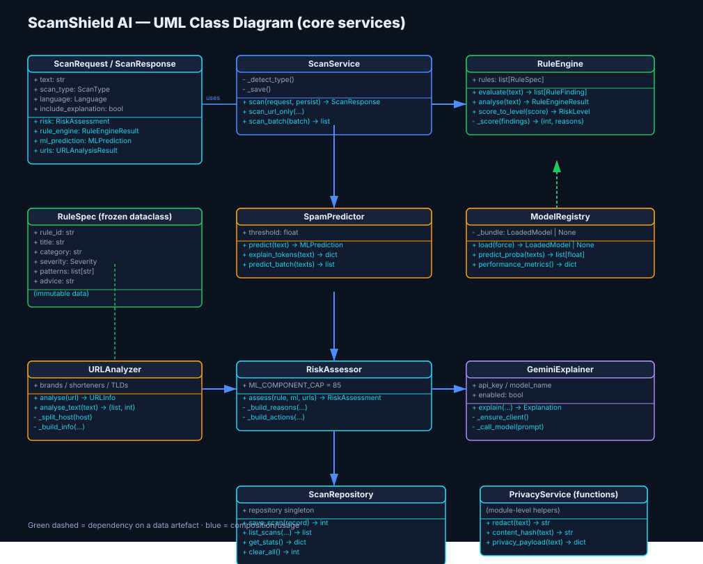

# ScamShield AI — Project Report

**An Explainable AI System for the Detection and Explanation of Scam, Spam and Phishing Messages**

MSc Computer Science · Samsung Innovation Campus (SIC) Project
Author: *(your name)* · Supervisor: *(name)* · Date: **November 2026**

---

## Abstract

Digital fraud delivered through SMS, WhatsApp and email has become the dominant form of
consumer-facing cybercrime in India. Existing protections are either invisible server-side
filters or generic user education; neither explains to an individual why a specific message
is dangerous. This project presents **ScamShield AI**, a modular system that combines three
independent detection layers — a deterministic rule engine, a supervised machine-learning
classifier, and a static URL analyser — behind a single explainable risk verdict, with
optional generative-AI narratives in English, Hindi and Hinglish.

The classifier was trained and evaluated on the UCI SMS Spam Collection (5,158 messages
after duplicate removal). Three algorithms were compared under a pre-declared selection
rule; Logistic Regression was selected with **accuracy 0.9855, precision 0.9520, recall
0.9297, F1 0.9407 and ROC-AUC 0.9985** on a stratified held-out test set of 1,032 messages.
The system is accompanied by 250 automated tests (79% statement coverage), including a test
that proves the URL analyser never opens a network connection, and a golden-file test that
holds all eleven demonstration samples to their documented risk levels.

The report deliberately documents a measured false positive — a genuine bank debit alert
scored MEDIUM — rather than tuning thresholds until every example passed.

**Keywords:** phishing detection, scam SMS, explainable AI, TF-IDF, logistic regression,
social engineering, Indian cybercrime, generative AI.

---

## 1. Introduction

### 1.1 Motivation

India's cybercrime reporting portal recorded a sustained rise in financial fraud executed
over messaging channels. The attacks share a structure: an authoritative sender, a
manufactured deadline, a link or a payment instruction, and a demand for credentials. The
victim's failure is rarely carelessness — it is that the message is engineered to suppress
deliberation.

Three practical gaps motivated this work:

1. **Opacity.** Spam filters are server-side and return a binary outcome. The user learns
   nothing and therefore cannot transfer the lesson to the next message.
2. **Channel mismatch.** SMS is not the only channel; WhatsApp, email and social DMs carry
   the same payloads, and a filter for one does not cover the others.
3. **Language.** Tooling that assumes English fails on Hinglish, which is how most
   India-targeted scams are actually written.

### 1.2 Objectives

| # | Objective | Delivered as |
|---|---|---|
| O1 | Detect scam indicators in messages and URLs | `rule_engine.py`, `url_analyzer.py` |
| O2 | Provide a statistical second opinion | `ml/training/train.py` |
| O3 | Explain *why*, in the user's language | `gemini_service.py` + deterministic fallback |
| O4 | Fuse layers into an auditable verdict | `risk_assessor.py` |
| O5 | Persist history without compromising privacy | `privacy.py`, `repositories.py` |
| O6 | Present it professionally | Streamlit dashboard, 6 pages |
| O7 | Prove it works | 250 automated tests + generated evaluation report |

### 1.3 Scope and non-goals

**In scope:** text-based messages and URLs; English, Hindi and Hinglish explanation; local
single-user deployment.

**Out of scope (and stated as such in the UI):** voice calls, image/QR analysis, live URL
reputation, multiuser authentication, and any claim of certainty about a website's safety.

---

## 2. Background and related work

Text spam classification is a well-established task. Naive Bayes with bag-of-words remains
a strong baseline; linear models on TF-IDF are competitive and interpretable; ensembles add
accuracy at the cost of size and transparency.

The distinctive contribution here is not a new classifier but an **architecture for
explainability**: rules and model are kept separate, each is reported to the user, and the
fusion policy is published as an API endpoint. Where a conventional system reports "spam,
0.94", this system reports *which* nine rules fired, *what text* matched them, what the model
thought independently, what the URL analyser found without visiting the link, and what the
user should do next.

Recent generative AI introduces both an opportunity (plain-language explanation in low-
resource languages) and a hazard (confident hallucinated verdicts). This project adopts a
strict separation: **the LLM explains, it never detects.** The verdict is produced by
deterministic components and is therefore reproducible and testable; the LLM only rewrites
it.

---

## 3. System design

### 3.1 Architecture



Layers, from request to response:

1. **API layer** (`backend/api/`) — validation and serialisation only.
2. **Orchestration** (`scan_service.py`) — privacy → rules → ML → URLs → risk → explanation
   → persistence.
3. **Detection** — three independent services with no knowledge of each other.
4. **Fusion** (`risk_assessor.py`) — the only component that sees all three outputs.
5. **Explanation** (`gemini_service.py`) — consumes the finished verdict.
6. **Persistence** (`repositories.py`) — the only module that writes SQL.

### 3.2 Data flow



### 3.3 Use cases



### 3.4 Class structure



### 3.5 Key design decisions

| Decision | Alternative rejected | Reason |
|---|---|---|
| Three separate layers, never merged | One end-to-end model | Auditable reasoning; a user can verify a match; failures are isolated |
| `max()` fusion, not weighted average | Average of layer scores | Averaging lets a confident model be diluted by a silent rule engine; one strong independent signal should raise the alarm |
| Gemini explains only | Gemini as the classifier | LLM verdicts are non-deterministic, unauditable and can hallucinate confidence |
| URL analysis never contacts the network | Live fetch / sandbox | Safety, privacy and reproducibility; enforced by a test |
| SQL in one repository module | ORM everywhere | Zero-dependency footprint while keeping the PostgreSQL swap to one file |
| Two preprocessing pipelines | One shared cleaner | The rules need de-obfuscation (`K.Y.C` → `kyc`); the model needs natural text |

---

## 4. Methodology

### 4.1 Dataset

UCI SMS Spam Collection (dataset 228): 5,572 labelled messages. After removing **414
duplicate messages** — duplicates would leak test data into training and inflate accuracy —
and empty rows: **5,158 messages (4,516 ham, 642 spam; 12.4% spam)**.

Download is scripted (`ml/data/download_dataset.py`) so the corpus is reproducible rather
than committed.

### 4.2 Preprocessing

Two deliberate, separate pipelines:

**Rule engine view** (`normalize.canonicalize`): Unicode NFKC, removal of zero-width and
bidi control characters, Cyrillic/Greek homoglyph folding, per-word leetspeak folding
(guarded so numbers like `482913` and amounts like `Rs.1,250.00` survive), repeated-letter
collapsing, dotted-acronym joining (`K.Y.C` → `kyc`), `hxxp` → `http`.

**ML view** (`text_clean.clean_text`): lowercase, URLs → `<url>`, money → `<money>`, phones →
`<phone>`, digits → `#`, punctuation stripped, repeated letters collapsed. Stop-word removal
is **off by default**: removing words like *now*, *free* and *won* measurably hurt recall on
short messages.

### 4.3 Vectorisation and models

TF-IDF, `ngram_range=(1,2)`, `min_df=2`, `max_df=0.9`, `sublinear_tf=True`,
`max_features=30,000` → **9,629 features** on this corpus. The vectorizer is fitted on the
**training split only**.

Stratified 80/20 split (`random_state=42`): 4,126 train / 1,032 test. Five-fold stratified
cross-validation on the training split for a stability estimate.

| Model | Configuration rationale |
|---|---|
| MultinomialNB, `alpha=0.1` | Light smoothing; the SMS vocabulary is small, so high alpha washes out signal |
| LogisticRegression, `C=10`, `class_weight="balanced"`, `liblinear` | Weak regularisation; balanced weights handle the 1:7 imbalance without duplicating rows |
| RandomForest, 300 trees, `min_samples_leaf=2`, `balanced_subsample` | Stable averaging; small leaves avoid fitting noise in 5k messages |

### 4.4 Selection rule (declared before evaluation)

1. Treat models whose test F1 is within **0.01** of the best as tied — this is smaller than
   the observed fold standard deviation (±0.0116 to ±0.0167), so the difference is noise.
2. Inside the tied set, prefer the higher **ROC-AUC** (threshold-independent ranking).
3. Still tied → prefer the simpler model.

### 4.5 Rule engine

40+ rules as declarative data in `rule_catalog.py`, each with an id, category, severity,
regex patterns, explanation and advice. Weights: info 0, low 6, medium 12, high 20,
critical 32.

Three scoring refinements, each added after observing a concrete failure:

* **Category de-duplication** — within one category only the heaviest hit counts in full;
  further hits contribute 6 points each, capped at two. Without this, *"urgent …
  immediately … right now"* added 36 points for saying one thing three times.
* **Context-only cap** — a link, a brand name or an OTP mention can contribute at most 10
  points, and only when a substantive rule also fired. A bank name alone is not a verdict.
* **Severity floor** — one critical-severity indicator guarantees ≥ 65 (HIGH); two or more
  guarantee ≥ 75 (CRITICAL). Justification: sharing an OTP is near-certain fraud mechanics,
  and reporting it as "medium" because no other category fired is a usability failure.
* **Genuine-transaction safeguard** — if the message structurally matches an automated bank
  alert and no high/critical rule fires, the score is capped at 15 and the ML component is
  damped (see §6.3). This cannot be exploited: any real scam in that shape triggers the
  link, KYC, OTP, threat or payment rules.

Eight **rule combinations** add extra weight when two rules co-occur (KYC + link, OTP +
link, urgency + threat, payment + threat, job + payment, prize + payment, credential +
non-HTTPS, APK + payment) — because these pairs are categorically more dangerous than the
sum of their parts.

### 4.6 URL analysis

Static checks only: scheme safety (`javascript:`, `data:`), HTTPS, IPv4-literal hosts,
shorteners, punycode decoding, homoglyph detection, high-abuse TLDs, subdomain depth,
brand-look-alike detection against a curated brand table with allow-listed genuine domains,
phishing keywords in host and path, embedded credentials (`user@host` trick), unusual ports,
executable downloads, double extensions and percent-encoding.

Privacy/safety guarantee: **no DNS lookup, no HTTP request.** Enforced by
`test_never_makes_network_calls`, which patches `socket.connect` and asserts zero calls.

### 4.7 Risk fusion

```
ml_component  = min(85, P(spam) × 100)          damped ×0.5 if P(spam) < 0.60
                                                 damped ×0.25 for genuine-alert structure
url_component = highest URL score in the message
final_score   = max(rule_score, ml_component, url_component) + agreement_bonus
```

Agreement bonus: +5 when two independent components are ≥ 35, +8 when three are.

Thresholds: LOW 0–19, MEDIUM 20–44, HIGH 45–69, CRITICAL 70–100.

The fusion policy, weights and thresholds are published at
`GET /api/v1/scan/explain-scoring`, and a test asserts the published weights equal
`Severity.weight` so the documentation cannot drift from the code.

---

## 5. Implementation

### 5.1 Technology stack

| Layer | Technology | Rationale |
|---|---|---|
| API | FastAPI, Pydantic v2, Uvicorn | Typed contracts, automatic OpenAPI docs, fast |
| ML | scikit-learn, pandas, NumPy, joblib | Standard, reproducible, no deep-learning overhead |
| GenAI | Google Gemini (`google-genai`) | Strong multilingual quality; optional by design |
| Storage | SQLite (raw `sqlite3`) | Zero setup for a demo; PostgreSQL-ready by design |
| UI | Streamlit + custom CSS + Altair | Professional presentation with a single-language codebase |
| Tests | Pytest (`AppTest` for the UI) | 250 tests, ~6 s |

### 5.2 Privacy engineering

* Redaction of phone numbers, emails, card numbers, OTP values, UPI IDs, IFSC and Aadhaar
  patterns before storage **and** before any text is sent to Gemini.
* Salted SHA-256 fingerprint for duplicate detection without plaintext.
* `STORE_RAW_MESSAGE=false` disables plaintext persistence entirely.
* The detail endpoint returns raw text only with explicit `?include_raw=true` **and** when
  the deployment permits it.
* Retention cap (`HISTORY_MAX_ROWS`, default 5,000) trims the oldest rows after each write.
* One-click history deletion in the UI.

### 5.3 Generative AI integration

The prompt carries the verdict, the triggered findings with matched text, and the redacted
message. The system instruction forbids inventing findings, forbids certainty claims, forbids
declaring a message safe, and requires a fixed JSON schema. Output is parsed defensively
(markdown fences, prose wrappers, missing fields).

Failure ladder — every branch returns a usable object:
`disabled → no key → no SDK → API exception → unparsable output → missing fields →
deterministic fallback` (available in all three languages).

---

## 6. Evaluation

### 6.1 Model comparison (measured)

Held-out test set, 1,032 messages, stratified 80/20 split, `random_state=42`.

| Model | Accuracy | Precision (spam) | Recall (spam) | F1 | ROC-AUC | CV F1 (5-fold) | Train time | Selected |
|---|---|---|---|---|---|---|---|---|
| MultinomialNB | 0.9845 | 0.9828 | 0.8906 | 0.9344 | 0.9896 | 0.9510 ± 0.0140 | 0.00 s | |
| **LogisticRegression** | **0.9855** | **0.9520** | **0.9297** | **0.9407** | **0.9985** | 0.9372 ± 0.0116 | 0.01 s | ✅ |
| RandomForest | 0.9864 | 0.9750 | 0.9141 | 0.9435 | 0.9982 | 0.9312 ± 0.0167 | 1.40 s | |

**Confusion matrix — Logistic Regression**

|  | pred ham | pred spam |
|---|---|---|
| **actual ham** | 898 | 6 |
| **actual spam** | 9 | 119 |

**Classification report**

```
              precision    recall  f1-score   support

         ham       0.99      0.99      0.99       904
        spam       0.95      0.93      0.94       128

    accuracy                           0.99      1032
   macro avg       0.97      0.96      0.97      1032
weighted avg       0.99      0.99      0.99      1032
```

### 6.2 Discussion of model selection

Random Forest has the highest F1 by **0.0028** — one fifth of the cross-validation spread —
so it is statistically tied. Within the tied set, Logistic Regression has the best ROC-AUC
(0.9985 vs 0.9982). It is also 20× smaller (162 KB vs 3.3 MB), predicts in microseconds,
has better-calibrated probabilities and exposes per-term coefficients. For a project whose
stated objective is explainability, that is decisive.

The choice is defensible on a second axis too: the 9 missed spam messages (false negatives)
are the costly error, and Logistic Regression's recall (0.9297) exceeds Random Forest's
(0.9141).

### 6.3 System-level evaluation

Eleven curated demonstration messages spanning nine attack categories plus two controls were
run through the full HTTP pipeline. Ten match their documented expected risk. Results:

| Sample | Category | Risk | Score | Rule | ML |
|---|---|---|---|---|---|
| KYC phishing SMS | phishing | CRITICAL | 100 | 100 | 0.92 |
| OTP vishing | OTP | CRITICAL | 100 | 94 | 0.66 |
| UPI QR refund scam | payment | CRITICAL | 90 | 78 | 0.96 |
| Lottery prize lure | reward | CRITICAL | 90 | 76 | 1.00 |
| Fake WFH job | job | CRITICAL | 86 | 79 | 0.81 |
| Digital arrest | impersonation | CRITICAL | 100 | 100 | 0.73 |
| Malicious APK | malware | CRITICAL | 100 | 100 | 0.95 |
| Hinglish scam | language | CRITICAL | 100 | 100 | **0.07** |
| Credentials-in-URL | URL | CRITICAL | 85 | 80 | n/a |
| Genuine chat | control | LOW | 0 | 0 | 0.01 |
| Genuine bank alert | control | **MEDIUM** | 20 | 10 | 0.82 |

Two findings deserve prominence in a viva.

**(a) The Hinglish case validates the architecture.** The classifier returns P(spam) = 0.07 —
it is *wrong* — while the rules score 100. A single-model system would have failed here. The
disagreement is visible in the UI rather than hidden.

**(b) The bank-alert case validates the honesty policy.** A genuine SBI debit alert was
initially scored CRITICAL. Root cause: the 2005-era corpus barely contains transactional
alerts, so the model returns 0.82 for them — a clean demonstration of distribution shift
despite 98.55% test accuracy. Two mitigations were added (a weight-0 structural rule and an
ML damping factor, applied only when no high/critical rule fires), bringing it to MEDIUM
(20/100). It was then **left at MEDIUM**, documented in the sample metadata, asserted in the
test suite and discussed in `docs/LIMITATIONS.md`.

### 6.4 Software quality

| Metric | Value |
|---|---|
| Automated tests | **250 passing** in ~6 s |
| Statement coverage | **79%** (backend + ml) |
| Test files | 7, organised by build phase |
| Notable tests | network-safety proof, golden sample expectations, weight/doc consistency, documented false positive, SQL-injection payloads, secret-leakage checks, concurrent writes |

---

## 7. Limitations

Summarised here; the full discussion is in `docs/LIMITATIONS.md`.

1. **English-only classifier.** Hindi/Hinglish detection comes from curated keyword rules.
2. **Documented false positive** on genuine bank alerts (MEDIUM, 20/100).
3. **Finite rules** — novel phrasing can evade them.
4. **URL analysis is pattern-based** — no live reputation or sandboxing.
5. **The LLM explains, it never detects** — by design.
6. **The risk score is a heuristic**, not a calibrated probability.
7. **Metrics measure 2005-era English SMS**, not modern Indian phishing traffic.
8. **SQLite is single-writer**; no rate limiting or multiuser auth in this build.

---

## 8. Conclusion and future work

ScamShield AI meets its objectives: it detects common scam patterns across messaging
channels, explains its reasoning in three languages, degrades gracefully when optional
components are unavailable, and protects user privacy by default. Its distinguishing
property is not accuracy — 98.55% on this dataset is unsurprising for a well-studied task —
but **auditability**: every point of the risk score is traceable to a rule, a probability or
a URL indicator, and the fusion policy itself is a published endpoint.

The most valuable next step is not a better algorithm. It is **better data**: a modern,
labelled corpus of real Indian scam messages, annotated by two reviewers with reported
inter-annotator agreement, which would let the model be judged on the traffic it is actually
meant to protect. That, together with per-language models and optional reputation lookups,
would turn a demonstration into a deployable tool.

---

## References

1. Almeida, T. A., Hidalgo, J. M. G., & Yamakami, A. (2011). *Contributions to the study of
   SMS spam filtering: New collection and results.* ACM DocEng.
2. UCI Machine Learning Repository. *SMS Spam Collection Dataset* (id 228).
   <https://archive.ics.uci.edu/dataset/228/sms+spam+collection>
3. Pedregosa, F. et al. (2011). *Scikit-learn: Machine Learning in Python.* JMLR 12.
4. Ramos, J. (2003). *Using TF-IDF to determine word relevance in document queries.*
5. Google. *Gemini API documentation.* <https://ai.google.dev/>
6. OWASP Foundation. *Input Validation Cheat Sheet* and *SQL Injection Prevention*.
7. Government of India. *National Cyber Crime Reporting Portal.* <https://cybercrime.gov.in>

---

## Appendix A — Reproducing every number in this report

```powershell
python -m ml.data.download_dataset      # dataset: 5,158 rows after de-duplication
python scripts/train_models.py          # metrics, comparison table, artefacts
python -m ml.evaluation.evaluate        # report + confusion-matrix PNG
pytest -q                               # 250 tests
python scripts/seed_demo_data.py --clear  # the 11-sample evaluation table
```

## Appendix B — Artefact inventory

| Path | Content |
|---|---|
| `models/model_logistic_regression.joblib` | classifier + vectorizer + metadata (162 KB) |
| `models/metrics.json` | all measured metrics + comparison + selection reason |
| `ml/evaluation/reports/evaluation_report.md` | generated human-readable report |
| `ml/evaluation/reports/confusion_matrix.png` | confusion-matrix figure |
| `ml/vectorizers/tfidf_vectorizer.joblib` | TF-IDF vectorizer alone |
| `data/scamshield.db` | SQLite history (git-ignored) |
